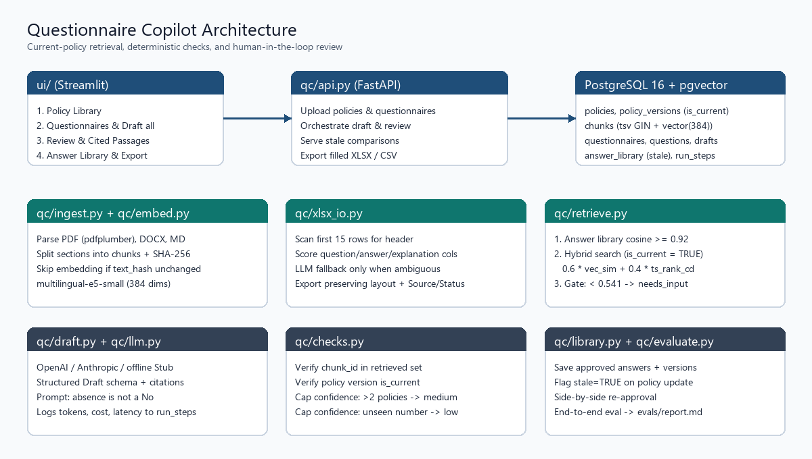

# Questionnaire Copilot: Answer security questionnaires in hours instead of days, from your current policies, with a source for every answer

Built for security leads, compliance reviewers, and sales engineers who answer 50 to 300 question B2B security spreadsheets by hand. It drafts answers strictly from current policy versions, cites exact sections, refuses when policies are silent, and flags approved answers when a policy changes.
Video (3 min): pending recording

## The problem

When teams answer security questionnaires manually or with a naive RAG assistant, three things break:
1. Answers come from outdated policy versions (last year's retention period or key rotation schedule).
2. Answers lack section-level citations, forcing senior reviewers to re-read every policy.
3. Questions with no documented answer get guessed instead of escalated as `Needs input`.

## What it does

- **Policy library:** Ingests PDF, DOCX, and Markdown policies with version numbers and effective dates; only `is_current` versions are ever retrieved or cited.
- **Smart Excel & CSV import:** Scans the first 15 rows per sheet to detect headers, question columns, answer columns (including `Yes/No/N.A.` sheets), and explanation columns, even with merged title blocks or multiple sheets.
- **Hybrid retrieval + drafting:** Reuses approved, non-stale answers from the Answer Library (`cosine >= 0.92`), otherwise runs hybrid vector (`intfloat/multilingual-e5-small`) + full-text (`ts_rank_cd`) search over current policy chunks. Questions below `MIN_EVIDENCE` (`0.541`) are marked `Needs input` without calling an LLM.
- **Post-draft code checks:** Verifies every cited `chunk_id` is in the retrieved set and belongs to a current version, enforces `can_answer=false` -> `Needs input`, caps confidence when >2 policies are cited, and caps confidence at `low` if a number in the answer is absent from the cited passages.
- **Review & staleness detection:** Reviewers approve, edit, or reject drafts side-by-side with cited passages. Uploading a new policy version automatically marks dependent library entries stale (`Policy changed since approval`) until re-approved.
- **Layout-preserving export:** Writes answers, explanations, `Source`, and `Status` back into the original Excel or CSV layout.

## Results (from evals/report.md)

The numbers below are from `evals/report.md` run with `openai` / `auto/fast` (OmniRoute gateway).

### Questionnaire A (calibration set, 60 questions)

| Metric | Value | Target |
| --- | --- | --- |
| Answer correctness | 84.6% (below target) | 90%+ |
| Citation correctness | 92.3% | 90%+ |
| Stale-version citations | 0 | 0 |
| Needs-input recall | 100.0% | 100% |
| Needs-input precision | 88.9% | 85%+ |
| Edit rate | 21.2% | report |
| Cost / Time | $0.0000 / 92.3s | report |

### Questionnaire B (held-out, 40 questions)

| Metric | Value | Target |
| --- | --- | --- |
| Answer correctness | 80.0% (below target) | 90%+ |
| Citation correctness | 100.0% | 90%+ |
| Stale-version citations | 0 | 0 |
| Needs-input recall | 100.0% | 100% |
| Needs-input precision | 100.0% | 85%+ |
| Reuse rate | 62.5% | report |
| Cost / Time | $0.0000 / 16.1s | report |

Answer correctness missed the 90%+ target on A (84.6%) and B (80.0%) mainly because two-part yes/no questions in A were drafted as `text` instead of `yes`, and those `text` library entries were then reused on yes/no questions in B. Citation correctness, stale-version isolation, needs-input recall/precision, and staleness detection all met or exceeded their targets.

### Staleness check (`data-retention` v4)

| Metric | Value | Target |
| --- | --- | --- |
| Expected / Flagged stale entries | 4 / 4 | 4 / 4 |
| Staleness detection | 100.0% | 100% |

## How it works

## Run it

    cp .env.example .env    # add OPENAI_API_KEY or ANTHROPIC_API_KEY
    make demo

`make demo` starts PostgreSQL 16 (`pgvector`), seeds the 11 synthetic policies (14 versions) and 2 questionnaires (`60 + 40` questions), and launches FastAPI (`http://127.0.0.1:8000`) and Streamlit (`http://localhost:8501`).

Additional commands:
- `make test`: run offline tests (`199` tests using `StubLLM` and `FakeEmbedder` / `E5Embedder`)
- `make lint`: run `ruff check` and `ruff format --check`
- `make eval`: run the 5-step end-to-end evaluation and write `evals/report.md`
- `make down`: stop containers and remove volumes

Documentation: [Reviewer User Guide](docs/user-guide.md), [Production Notes](docs/production.md), [Decisions Log](docs/decisions.md), [Sources](docs/sources.md).

## What runs on a model and what does not

| Step | Model | Code |
| --- | --- | --- |
| Find header and question column | only when heuristic scoring is ambiguous | default |
| Retrieve evidence (library + current policies) | | yes |
| Gate `Needs input` below `MIN_EVIDENCE` | | yes (before any model call) |
| Draft structured answer and explanation | yes | |
| Validate citations, current versions, numbers | | yes |
| Reuse approved answers & flag stale entries | | yes |

## Limits and what a production version adds

- **Current limits:** Single-tenant local setup, no SSO/user accounts, and manual file upload (Excel and CSV questionnaires only; no Word/PDF questionnaires).
- **Production additions:** OIDC/SAML SSO, Google Drive / SharePoint / Confluence policy connectors, managed Postgres + background worker queues, and tenant isolation (see [docs/production.md](docs/production.md)).

## About

Built by Faycal Raghibi with synthetic data (Northbeam Cloud). Not client work. Available for custom versions on Upwork.
